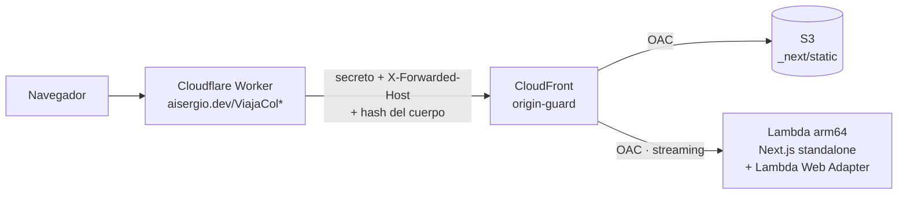

# Viaja Colombia

[](https://github.com/aisergio/ViajaCol/actions/workflows/ci.yml)
[](https://github.com/aisergio/ViajaCol/actions/workflows/security.yml)
[](https://scorecard.dev/viewer/?uri=github.com/aisergio/ViajaCol)

Sitio turístico bilingüe (español / inglés) para descubrir sitios, fiestas, platos y experiencias de
Colombia y planear viajes con «Mi viaje». Prototipo académico de la asignatura **Arquitectura
Front-End** (Politécnico Grancolombiano).

> Estado: en construcción (Entrega 2). Publicado en https://aisergio.dev/ViajaCol desde `main`.

## Arquitectura (resumen)

- **Front-end y backend**: Next.js 16 (App Router, React Server Components, Server Actions) sobre Node.
- **Patrón**: MVVM con store compartido.
- **Infraestructura**: AWS (Lambda, CloudFront, S3, DynamoDB, Cognito) con Terraform, detrás de un
  Cloudflare Worker.
- **Proceso**: Spec-Driven Development con GitHub Spec Kit (`specs/`) y CI en GitHub Actions.

La documentación detallada estará en [`docs/`](docs/); las decisiones de arquitectura, en
[`docs/adr/`](docs/adr/).

### Despliegue



- **Infraestructura:** está en [`infra/live`](infra/live) y en el módulo
  [`infra/modules/nextjs-zone`](infra/modules/nextjs-zone).
- **Publicación:** la hace [`deploy.yml`](.github/workflows/deploy.yml). Compila en GitHub, pide la
  aprobación de `production` en su propio job, publica en un runner de CodeBuild y restaura moviendo
  el alias `live`.
- **Guía y evidencia:** el paso a paso está en
  [`specs/003-plataforma/quickstart.md`](specs/003-plataforma/quickstart.md) y la evidencia, en
  [`evidencia.md`](specs/003-plataforma/evidencia.md).
- **Decisiones:** ADR [0003](docs/adr/0003-nextjs-en-lambda-con-web-adapter.md),
  [0004](docs/adr/0004-borde-cloudflare-y-origen-oculto.md) y
  [0005](docs/adr/0005-runner-de-codebuild-para-publicar.md).

## Cómo correrlo

Requisitos: Node.js 22.13 o superior y npm 11.

```bash
npm install
npm run dev            # http://localhost:3030/ViajaCol
```

| Comando | Qué hace |
|---|---|
| `npm run lint` | ESLint (reglas de Next.js y TypeScript) |
| `npm run typecheck` | TypeScript estricto |
| `npm run test:coverage` | Vitest: ViewModels, modelos y catálogo de textos (cobertura ≥ 80 %) |
| `npm run build` | Build de producción (las páginas se prerenderizan) |
| `npm run e2e` | Playwright + axe sobre el build de producción |

## Estructura

```
apps/web/          aplicación Next.js (rutas en src/app/[locale], funcionalidades en src/features)
packages/ui/       tokens de diseño (OKLCH) y componentes base
packages/i18n/     catálogo de textos ES/EN
specs/             especificaciones de Spec Kit (una carpeta por funcionalidad)
infra/             Terraform (bootstrap y stacks)
docs/              ADR, guías de aprendizaje y seguridad
```

## Equipo

Proyecto de un grupo de tres estudiantes: un integrante desarrolla y los otros dos revisan pull
requests, el documento y el video.

## Licencia

Código bajo licencia [MIT](LICENSE). Las imágenes conservan sus licencias originales (ver créditos
en el sitio).
