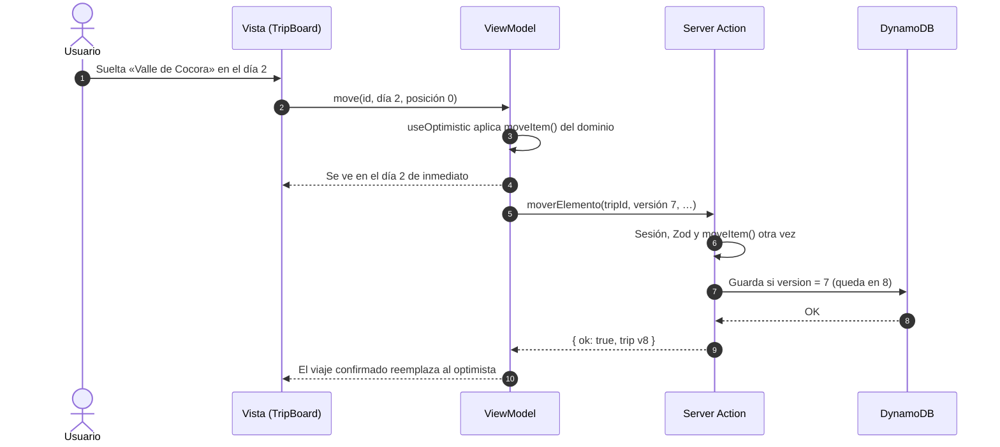
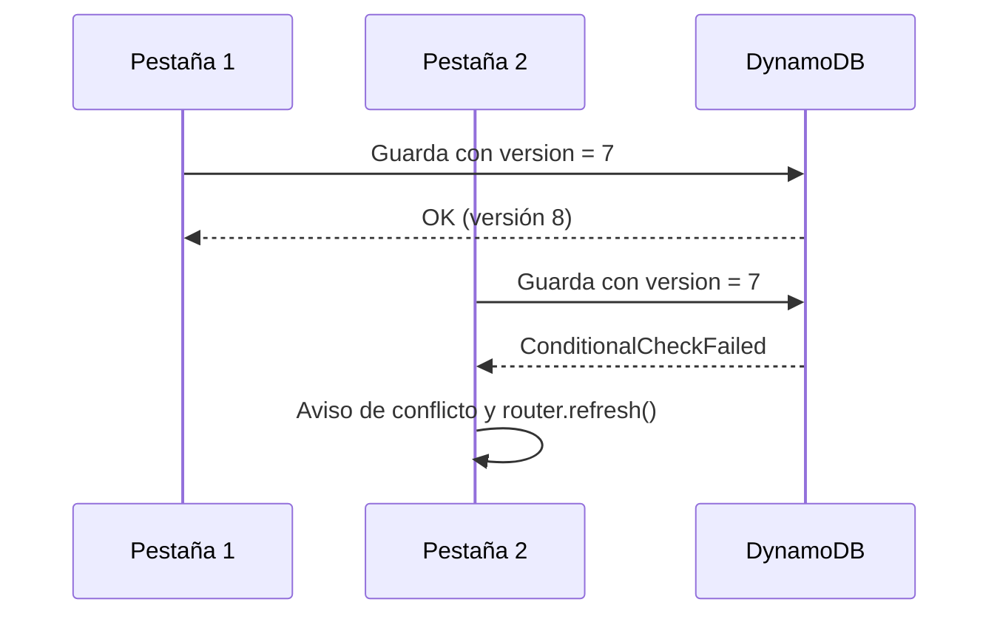

# Guía: estado optimista y concurrencia en «Mi viaje»

Esta guía explica qué pasa cuando alguien mueve un elemento de su viaje, por qué el cambio se ve antes de
que responda el servidor y cómo se evita que dos pestañas se pisen.

## 1. Los tipos de estado del editor

| Estado | Dónde vive | Ejemplo |
|---|---|---|
| Del servidor | Props de la página y la última respuesta de una acción | El viaje en la versión 7 |
| Optimista | `useOptimistic` en `useTripEditorViewModel` | El elemento ya aparece en el día 2 |
| Local | `useState` de cada vista | El día elegido en «Mover a…» |
| Derivado | Se calcula en cada render | Grupos por día y totales del presupuesto |
| Global compartido | Store de Zustand con `persist` | El borrador sin cuenta |

Los totales del presupuesto nunca se guardan: salen de los elementos en cada render. Si se guardaran,
habría dos verdades que podrían no coincidir.

## 2. Recorrido de un cambio

- **La misma función dos veces:** `moveItem()` vive en `src/domain/trip.ts`. El navegador la usa para
  mostrar el cambio; el servidor, para guardarlo. Por eso lo que se ve y lo que se guarda coinciden.
- **El servidor no confía en el navegador:** vuelve a validar todo y toma el usuario de la sesión. El
  navegador nunca envía el `sub`.
- **Si la acción falla**, React descarta el estado optimista y queda el confirmado: el elemento vuelve a
  su lugar y el aviso explica por qué.

## 3. Dos pestañas sobre el mismo viaje

La segunda pestaña no pisa el cambio de la primera: recibe `conflicto`, avisa y recarga el viaje en la
versión 8. Si el usuario quiere, repite su cambio sobre esa versión.

## 4. Por qué las acciones van en fila

Si alguien sube un elemento y enseguida baja otro, las dos acciones saldrían con la versión 7 y la
segunda chocaría con la primera, aunque las dos son de la misma pestaña. Por eso el ViewModel las envía
una tras otra (`send()`), y cada una usa la última versión que confirmó el servidor.

## 5. Lo que aprendimos al construirlo

- **`setState` después de `await`:** dentro de una transición asíncrona, las actualizaciones que vienen
  después de un `await` se envuelven otra vez en `startTransition`.
- **React 19 agrupa las transiciones en curso:** sus resultados se confirman juntos cuando todas
  terminan. En las pruebas, una acción que nunca terminaba retenía las de las pruebas siguientes. Por
  eso cada prueba libera sus acciones al final.
- **El foco al cambiar de lista:** mover un elemento a otro día lo desmonta y lo vuelve a montar en otra
  lista, y el foco se pierde. El ViewModel pide el foco para el elemento movido (`focusRequest`) y la
  vista lo devuelve al botón «Mover».
- **Zod y los refinamientos del objeto:** Zod los ejecuta aunque un campo haya fallado. Con una fecha
  inicial inválida, la regla «fin antes de inicio» marcaba también el campo «Hasta». Las reglas entre
  fechas ahora solo se revisan si las dos fechas son válidas.
- **El compilador de React y las refs:** un objeto que mezcla una ref con valores hace que el lint trate
  cualquier lectura de ese objeto como lectura de la ref. La vista crea sus refs y las pasa al
  ViewModel.

## 6. Cómo verlo en las DevTools

- **Redux DevTools:** el store «Mi viaje · borrador» muestra cada acción (`borrador/agregar`,
  `borrador/quitar`, `borrador/vaciar`) en desarrollo.
- **React DevTools:** en `TripWorkspace`, el hook `useOptimistic` muestra el viaje optimista mientras la
  acción está pendiente.
- **Red:** cada cambio es un `POST` a la misma página con la cabecera `Next-Action`. Con la red en «Slow
  3G» se ve el estado optimista antes de la respuesta.
