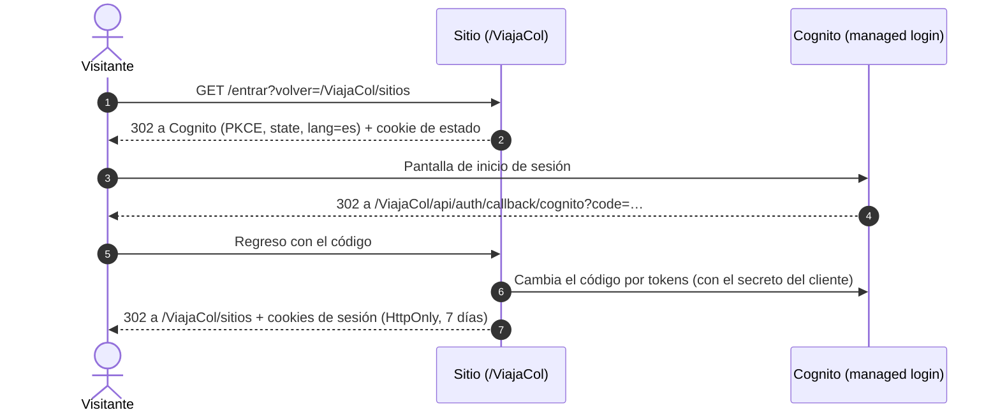

# Guía: cómo funciona la sesión (Cognito, Better Auth y el `basePath`)

Esta guía explica, paso a paso, qué pasa cuando alguien pulsa «Entrar» en Viaja Colombia, dónde vive
la sesión y por qué el código tiene un envoltorio en la ruta de autenticación.

## 1. El recorrido de un inicio de sesión



- **PKCE y `state`:** impiden que alguien use un código robado o inicie el flujo por el usuario.
- **El secreto del cliente:** solo lo conoce el servidor; lo lee de SSM al arrancar.
- **Las contraseñas:** las ve solo Cognito. El sitio nunca las recibe.

## 2. Dónde vive la sesión

Sin base de datos: todo está en cookies que el navegador no puede leer con JavaScript.

| Cookie | Para qué |
|---|---|
| `__Secure-viajacol.session_token` | Token firmado de la sesión |
| `__Secure-viajacol.session_data` | El usuario y la fecha de vencimiento, cifrados (JWE) |
| `viajacol.con_sesion` | Solo dice «hay sesión»; no tiene datos y sí se puede leer |

Para verlas: DevTools → Application → Cookies → `https://aisergio.dev`.

**La identidad estable es el `sub` de Cognito.** Sin base de datos, el identificador que inventa Better
Auth cambia en cada inicio de sesión, así que el perfil y «Mi viaje» se guardan con el `sub`.

## 3. Por qué las páginas públicas siguen siendo estáticas

Si el layout leyera la sesión, cada página tendría que generarse en cada petición y la caché dejaría
de servir. Por eso el menú de cuenta es un componente de cliente:

1. Mira si existe `viajacol.con_sesion`. Si no existe, muestra «Entrar» y no pregunta nada.
2. Si existe, pide `GET /ViajaCol/api/cuenta/yo` y muestra el nombre.
3. Si el servidor responde 401, borra el indicador y vuelve a «Entrar».

## 4. El envoltorio del `basePath`

Next.js le quita el `basePath` a la URL que reciben los Route Handlers:

```text
Petición del navegador:     /ViajaCol/api/auth/callback/cognito
URL que ve el Route Handler: /api/auth/callback/cognito
```

Better Auth enruta con la ruta completa, así que sin ayuda responde 404. La solución:

- `baseURL` con solo el origen (`https://aisergio.dev`);
- `basePath: '/ViajaCol/api/auth'`;
- `withBasePath()` le devuelve el prefijo a la URL antes de pasarla a Better Auth.

## 5. Cómo se protege lo privado

- `proxy.ts` manda a «Entrar» a quien abre «Mi cuenta» sin cookie de sesión. Es solo un atajo.
- La página y cada Server Action vuelven a verificar la sesión en el servidor. Una cookie inventada o
  alterada no pasa, porque la firma y el cifrado no validan.
- Las acciones nunca reciben el `sub` del navegador: lo toman de la sesión.

## 6. Para practicar

- En DevTools → Network, pulsar «Entrar» y seguir las tres redirecciones.
- Borrar `viajacol.con_sesion` y recargar: el menú muestra «Entrar» aunque la sesión siga viva; al
  pulsarlo, Cognito recuerda al usuario y lo devuelve enseguida.
- Cambiar una letra de `__Secure-viajacol.session_data` y abrir «Mi cuenta»: el sitio pide entrar otra
  vez.
